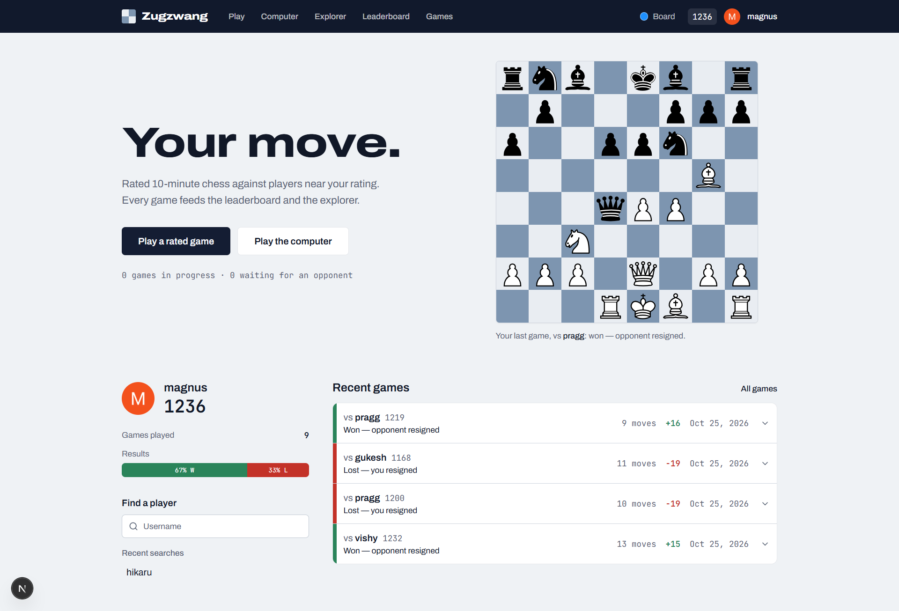
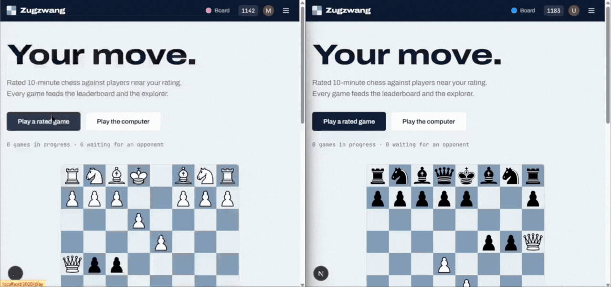
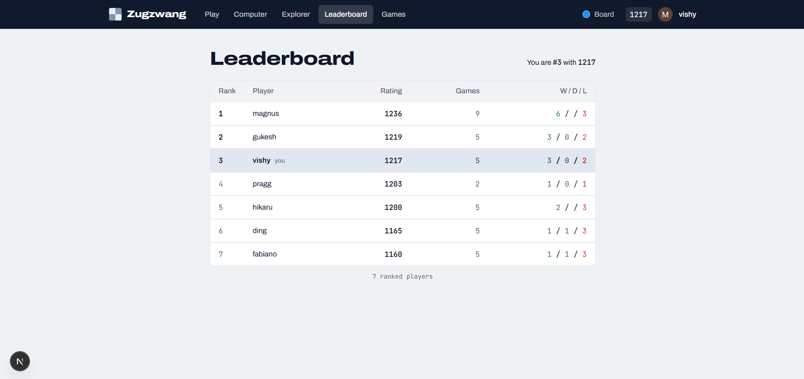
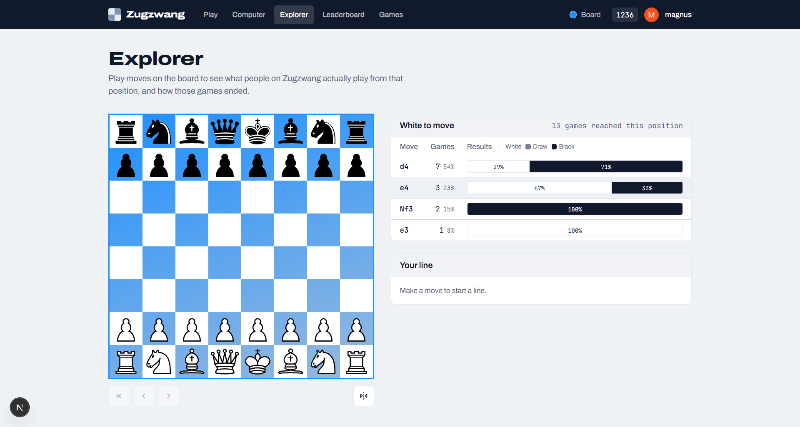
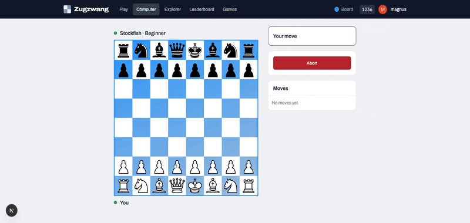
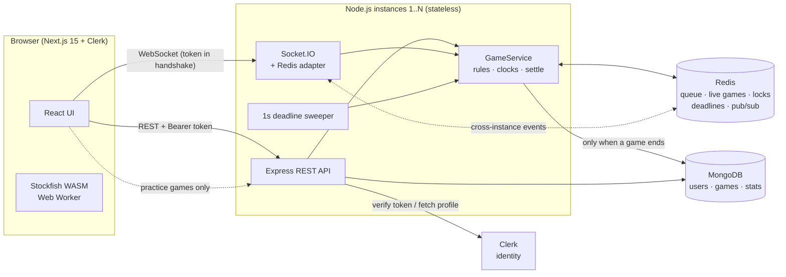
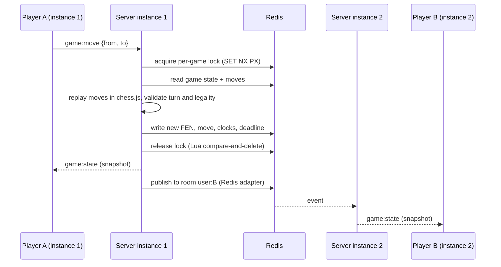
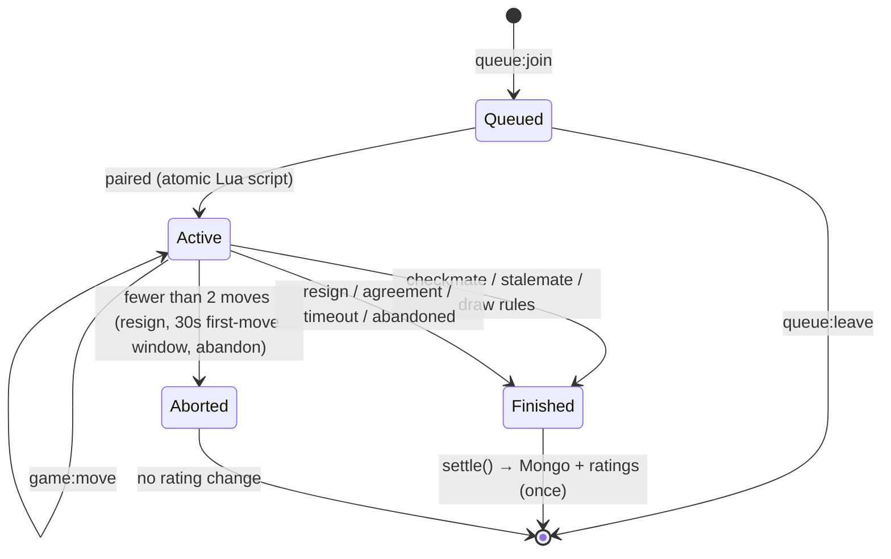
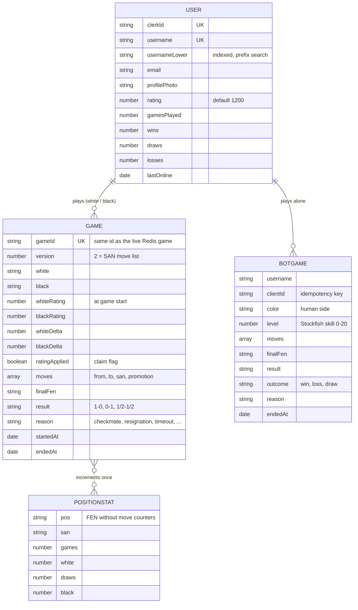

# ♟️ Zugzwang: a distributed, real-time chess platform

Sign in, get matched with a player of similar rating, and play a full game of chess live, with server-enforced rules, clocks, resignation and draw offers, Elo ratings, a leaderboard and an opening explorer built from the games played on the site. You can also practise against Stockfish in the browser.

The project focuses on **server-authoritative game logic, atomic matchmaking, and a real-time layer that scales horizontally**: any server instance can serve any player, and no game state lives in process memory.

<p align="center">
  
</p>

## 🎬 See it in action

Two players in two browser windows: both join the queue, get paired, and every move appears on the other board instantly. The game is validated, clocked and settled on the server.

<p align="center">
  
</p>

---

## Contents

- [See it in action](#-see-it-in-action)
- [Features](#-features)
- [System architecture](#-system-architecture)
- [Key design decisions](#-key-design-decisions)
- [Game lifecycle](#-game-lifecycle)
- [Data model](#-data-model)
- [Redis keys](#-redis-keys-live-state)
- [Real-time protocol](#-real-time-protocol-socketio)
- [REST API](#-rest-api)
- [Tech stack](#-tech-stack)
- [Project structure](#-project-structure)
- [Getting started](#-getting-started)
- [Configuration](#-configuration)
- [Testing](#-testing)
- [Deployment](#-deployment)
- [Scaling notes](#-scaling-notes)
- [Known trade-offs](#-known-trade-offs)
- [Roadmap](#-roadmap)

---

## ✨ Features

**Live play**
- Rating-aware matchmaking: the accepted rating gap starts at ±100 and widens by 20 points for every second you wait
- Full chess rules validated on the server with **chess.js**: legal moves only, turn order, check, checkmate, stalemate, castling, en passant, promotion, threefold repetition, 50-move rule, insufficient material
- Server-side **clocks** (10+0 by default, increment supported); flagging loses, except against insufficient material, which is a draw
- **Resign** and **draw offers** (offer / accept / decline)
- Reconnect-safe: refresh or drop your connection and you land back in your game. You forfeit only if you stay away longer than a grace period
- Games with fewer than 2 moves are **aborted**, with no rating change
- Drag-and-drop and click-to-move, legal-move hints, last-move and check highlighting, promotion picker, switchable board themes

**Ratings, history and discovery**
- **Elo** ratings (K = 32) computed from both players' ratings and applied exactly once per game
- **Game history** with numbered pages, moves in standard notation (SAN), a final-position board, and *how* each game ended: checkmate, resignation, on time, draw by agreement / stalemate / repetition / 50-move rule / insufficient material, timeout vs insufficient material, opponent left
- **Leaderboard**: players ranked by rating, paginated, ties share a rank, your own rank shown
- **Opening explorer**: a board where you play moves and see what players on this site actually played from that position, with games, share and white / draw / black results
- Profiles and debounced, case-insensitive player search

<p align="center">
  
</p>

<p align="center">
  
</p>

**Play the computer**
- `/bot`: practice against **Stockfish** (single-threaded "lite" WebAssembly build in a Web Worker, so nothing runs on the game server), five strength levels, either colour
- Practice games are **unrated**, never counted in the leaderboard or explorer, stored in their own collection, and visible only to the player who played them

<p align="center">
  
</p>

---

## 🏗 System architecture



Everything that changes during a game happens in **Redis**. **MongoDB** is written only when a game finishes (and when users are created). Clerk authenticates the user; the server never trusts a username sent by the client.

### Anatomy of a move



---

## 🧠 Key design decisions

| Decision | Why |
|---|---|
| **The server is the only source of truth.** Clients send *intents* (`{from, to, promotion}`, resign, …) | Illegal moves, out-of-turn moves and moving the opponent's pieces are impossible by construction. The server replays the stored moves with chess.js, so it also gets repetition and 50-move detection right. |
| **No game state in process memory.** The queue and every live game (FEN, moves, clocks, draw offers, disconnect flags) live in Redis | A server restart loses nothing, and a player can be connected to any instance. |
| **Matchmaking is one Lua script** | Redis runs it atomically, so several instances racing for the same waiting player can never create two games or put a user in two games. |
| **Per-game lock** (`SET NX PX` plus a Lua compare-and-delete release) around every mutation | Resign, disconnect and timeout can race each other; exactly one wins. Covered by a two-instance test. |
| **A game is settled in exactly one place** (`settle()`) | Result, reason, rating change and persistence all go through the same path. Redis is flipped to *finished* first, then MongoDB is written with 3 retries. If all retries fail, the game is parked in a Redis list for replay. |
| **No in-process timers for clocks.** Deadlines are Redis sorted sets, swept every second by *every* instance | Timeouts and abandonment still fire if the instance that handled the last move died. |
| **Socket.IO Redis adapter plus per-user rooms** (`user:{username}`) | `io.to(room).emit` reaches a player on any instance, and a reconnecting tab simply receives the next snapshot. There are no game rooms to keep in sync. |
| **Authentication verified server-side.** REST uses a Bearer token. Sockets send a token function in the handshake (a fresh token on every reconnect). Usernames come from Clerk's API | The client can't impersonate anyone. |
| **Ratings change exactly once.** Games have a unique `gameId`. A conditional write (`ratingApplied: false → true`) *claims* the update, and only the claimer applies ratings, counters and explorer stats | A retried save can't double-apply anything (at-most-once semantics, tested). |
| **Practice games are verified, not trusted.** The browser plays Stockfish, then sends the move list. The server replays it and derives the result | A forged "I won" is ignored. Only "I resigned" is taken on trust, and only if the game isn't already over. |

---

## 🔄 Game lifecycle



- **First-move window:** each side must make its first move within 30 s or the game is aborted. The clocks start once both sides have moved.
- **Disconnects:** the opponent is told, and the disconnected player has 30 s to return before forfeiting.
- **Timeout vs insufficient material:** if the player who did *not* flag cannot possibly checkmate (lone king, or king plus one minor piece against a bare king, or same-coloured bishops only), the game is a draw instead of a win on time.

**Elo**

```
expected = 1 / (1 + 10^((opponent − player) / 400))
delta    = round(K × (score − expected))      K = 32, score ∈ {1, ½, 0}
```

The change is zero-sum (the loser loses exactly what the winner gains) and ratings never fall below 100.

---

## 🗄 Data model

### MongoDB



| Collection | Indexes | Purpose |
|---|---|---|
| `users` | `clerkId` (unique), `username` (unique), `usernameLower`, **partial** `{rating: -1, usernameLower: 1}` where `gamesPlayed ≥ 1` | Identity and ratings, prefix search, leaderboard |
| `games` | **partial unique** `gameId`, `{white, endedAt: -1}`, `{black, endedAt: -1}` | Finished rated games and history. The partial index lets legacy documents without a `gameId` coexist. |
| `positionstats` | unique `{pos, san}`, `{pos, games: -1}` | Explorer: *most common moves first* is one indexed range read |
| `botgames` | unique `{username, clientId}`, `{username, endedAt: -1}` | Private practice games |

**Why these choices**
- **Reason values** on a finished game: `checkmate`, `resignation`, `timeout`, `timeout-insufficient`, `abandoned`, `stalemate`, `agreement`, `repetition`, `insufficient`, `fifty-move`.
- **Explorer positions** are keyed by the first four FEN fields, so different move orders that reach the same position share one record. Only the first 40 half-moves of each game are recorded, which keeps the collection small and the data meaningful.
- **Counters** (`gamesPlayed`, `wins`, `draws`, `losses`) are incremented in the same step that applies ratings, so the leaderboard never needs to aggregate the games collection.
- **The leaderboard index is partial**, covering only players who have played, so it stays small and every page is an index range scan.

### Redis keys (live state)

| Key | Type | Content |
|---|---|---|
| `chess:mm:queue` | sorted set | username → rating of waiting players |
| `chess:mm:entries` | hash | username → JSON (socket id, queue time) |
| `chess:game:{id}` | hash | status, players, ratings, FEN, clocks, draw offers, disconnect deadlines, result |
| `chess:game:{id}:moves` | list | the moves played, in order |
| `chess:lock:game:{id}` | string | per-game lock with an owner token and a TTL |
| `chess:user:{name}:game` | string | the user's current game id (prevents two games at once) |
| `chess:deadlines:clock` | sorted set | game id → when the side to move runs out of time |
| `chess:deadlines:abandon` | sorted set | `gameId:color` → when a disconnected player forfeits |
| `chess:settle:failed` | list | finished games whose MongoDB write failed (kept for replay) |

Finished games stay in Redis for an hour so late clients can still sync the result; active ones carry a 24 h safety TTL so orphaned keys can never live forever.

---

## 🔌 Real-time protocol (Socket.IO)

| Client → server | Meaning |
|---|---|
| `queue:join` / `queue:leave` | Start or cancel matchmaking |
| `game:move` `{from, to, promotion?}` | Play a move (squares like `"e2"`) |
| `game:resign` | Resign (aborts if fewer than 2 moves) |
| `draw:offer` / `draw:accept` / `draw:decline` | Draw handling |
| `game:sync` | Ask for the current state |

| Server → client | Meaning |
|---|---|
| `session:ready` `{username, game}` | Authenticated; `game` is set when resuming |
| `queue:waiting` / `queue:left` | Matchmaking status |
| `game:state` `GameSnapshot` | Full authoritative snapshot: FEN, moves, clocks, draw offer, disconnect deadlines |
| `game:over` `{result, reason, winner, ratings}` | The game ended |
| `game:error` `{action, code}` | Request rejected (`ILLEGAL_MOVE`, `NOT_YOUR_TURN`, …) |

Handlers are wrapped so that every event is rate limited and an exception can never crash the process.

## 🌐 REST API

All endpoints require `Authorization: Bearer <Clerk session token>` except `/health`.

| Method and path | Description |
|---|---|
| `GET /health` | Liveness check |
| `POST /api/users/sync` | Create or update the signed-in user from Clerk |
| `GET /api/users/search?q=` | Case-insensitive prefix search, backed by an index |
| `GET /api/users/:username` | Profile with recent games and stats |
| `GET /api/users/:username/games?page=&limit=` | Paginated game history (`games, total, page, pages`) |
| `GET /api/leaderboard?page=&limit=` | Ranked players plus your own `{rank, rating}` |
| `GET /api/explorer?fen=` | Most-played moves from a position, with results |
| `GET /api/stats` | Games in progress and players waiting |
| `POST /api/bot-games` | Save a finished practice game. The server replays and judges it. |
| `GET /api/bot-games?page=&limit=` | **Your own** practice games only |

Request bodies are capped at 10 kB, requests are rate limited per IP, and the app uses `helmet` and an explicit CORS allow-list.

---

## 🛠 Tech stack

| Layer | Technology |
|---|---|
| Frontend | Next.js 15 (App Router), React 19, TypeScript, Tailwind CSS, shadcn/ui, **chess.js** |
| Engine | **Stockfish 19** (WebAssembly, lite single-threaded build) in a Web Worker |
| Backend | Node.js, Express 5, **Socket.IO** with `@socket.io/redis-adapter`, **chess.js** |
| Data | **MongoDB** (Mongoose), **Redis** (state, locks, deadlines, pub/sub, Lua) |
| Auth | **Clerk** |
| Testing | Node's built-in test runner: unit, service tests against a real Redis, and two-server end-to-end tests over real sockets |
| Local infra | Docker Compose (MongoDB and Redis) |

---

## 📂 Project structure

```
/client/src
├── app/                       # Next.js routes
│   ├── page.tsx               #   home
│   ├── play/                  #   rated games
│   ├── bot/                   #   play the computer
│   ├── games/                 #   your history (rated and vs computer tabs)
│   ├── leaderboard/           #   ranked players
│   ├── explorer/              #   opening explorer
│   ├── profile/[user]/        #   public profile
│   └── components/            #   2DChessComponents (Board, PlayerBar, GameControls, …),
│                              #   games (GameList, MiniBoard), Navbar, Pagination
├── hooks/                     # useGameSocket (all real-time state), useClocks
└── lib/                       # api (authed axios), socket, stockfish wrapper, chess helpers, types

/server
├── src/
│   ├── index.js               # bootstrap and graceful shutdown
│   ├── config/                # env parsing and defaults
│   ├── app.js, routes/        # Express app and REST routes
│   ├── middleware/            # auth, error handler
│   ├── auth/                  # Clerk wrapper (verify token, fetch profile)
│   ├── sockets/               # io.js (auth, adapter), handlers.js (events, rate limit, sweeper)
│   ├── services/
│   │   ├── gameService.js     # rules and lifecycle: moves, resign, draws, clocks, settle
│   │   ├── gameStore.js       # Redis access: state, locks, deadlines
│   │   ├── lua.js             # atomic matchmaking and dequeue scripts
│   │   ├── rating.js          # pure Elo maths
│   │   ├── material.js        # "can this side still checkmate?" (timeout vs insufficient material)
│   │   ├── persistence.js     # write a finished game, ratings and explorer stats (idempotent)
│   │   ├── leaderboard.js, explorer.js, history.js, users.js, botGames.js
│   ├── models/                # Mongoose schemas: User, Game, PositionStat, BotGame
│   └── db/                    # Mongo and Redis connection helpers
├── scripts/rebuild-stats.js   # rebuild explorer and W/D/L counters from stored games
└── test/                      # rating, material, gameService (real Redis), api, e2e (two instances)
```

---

## ⚡ Getting started

**Prerequisites:** Node 20+, Docker (or your own MongoDB and Redis), and a free [Clerk](https://clerk.com) application with usernames enabled.

```bash
git clone https://github.com/Milin2710/zugzwang.git
cd zugzwang
docker compose up -d          # MongoDB and Redis
```

**Server**

```bash
cd server
npm install
cp .env.example .env          # set CLERK_SECRET_KEY
npm run dev                   # http://localhost:4000
```

**Client**

```bash
cd client
npm install                   # also copies the Stockfish files into public/stockfish
cp .env.example .env.local    # Clerk keys and NEXT_PUBLIC_BACKEND_URL
npm run dev                   # http://localhost:3000
```

**See horizontal scaling work:** start a second backend (`npm run dev:2`, port 4001) and a second frontend pointed at it (`NEXT_PUBLIC_BACKEND_URL=http://localhost:4001`, `npm run dev -- -p 3001`). Sign in as two different users, one on each, and play. They pair and stay in sync across instances. Add both frontend origins to `CORS_ORIGINS`.

**Rebuild derived stats** (the explorer positions and each player's W/D/L counters are derived from stored games; ratings are never touched):

```bash
cd server && npm run stats:rebuild
```

---

## ⚙️ Configuration

**Server (`server/.env`)**

| Variable | Default | Description |
|---|---|---|
| `PORT` | `4000` | HTTP and WebSocket port |
| `MONGODB_URI` | `mongodb://localhost:27017/zugzwang` | MongoDB connection string |
| `REDIS_URL` | `redis://localhost:6379` | Redis connection string |
| `CLERK_SECRET_KEY` | *(required)* | Used to verify session tokens and read usernames |
| `CORS_ORIGINS` | `http://localhost:3000` | Comma-separated frontend origins (CORS and Clerk authorized parties) |
| `TIME_CONTROL_MS` / `TIME_INCREMENT_MS` | `600000` / `0` | Initial time and increment |
| `FIRST_MOVE_MS` | `30000` | Window for each side's first move |
| `DISCONNECT_GRACE_MS` | `30000` | How long a disconnected player has to return |
| `MM_BASE_WINDOW` / `MM_WINDOW_GROWTH` | `100` / `20` | Matchmaking gap, and extra points per second waited |
| `ELO_K` | `32` | Elo K-factor |
| `CLERK_JWT_KEY` | *(optional)* | PEM public key for verifying tokens without a network call |

**Client (`client/.env.local`)**

| Variable | Description |
|---|---|
| `NEXT_PUBLIC_BACKEND_URL` | Base URL of the server (use `https` in production so sockets use `wss`) |
| `NEXT_PUBLIC_CLERK_PUBLISHABLE_KEY`, `CLERK_SECRET_KEY` | Clerk keys |

---

## 🧪 Testing

```bash
cd server
redis-server --port 6390 --save "" &      # or: TEST_REDIS_URL=redis://localhost:6379 npm test
npm test
```

The suite (60 tests) covers:
- **Rating maths** and the material rules (timeout vs insufficient material).
- **Game service against a real Redis:** legal and illegal moves, turn order, clocks, draws, resignation, reconnects, and racing resign / disconnect / timeout settling exactly once.
- **API behaviour** with mocked models: auth gating, validation, pagination, leaderboard ranks and ties, explorer keys, and the privacy of practice games.
- **End-to-end:** two real server instances sharing Redis, with two socket clients pairing across them and playing a game.

---

## 🚀 Deployment

The client is a standard Next.js app and fits **Vercel**. The server holds long-lived WebSocket connections and a 1-second sweeper, so it needs a host that keeps a Node process running (Render, Railway, a VPS) rather than serverless functions.

| Part | Option |
|---|---|
| Client | Vercel |
| Server | Render, Railway, or any VPS running Node (a `docker-compose` with Caddy works well) |
| MongoDB | MongoDB Atlas (free tier) |
| Redis | Upstash or Redis Cloud (free tiers), or Redis on the same host |

Set `NEXT_PUBLIC_BACKEND_URL` to the server's `https` URL, add the client's origin to `CORS_ORIGINS`, and add it to Clerk's allowed origins. Free tiers that sleep when idle (such as Render's) add a cold start for the first visitor; because live state is in Redis, games survive such restarts.

---

## 📈 Scaling notes

**Leaderboard.** A page is an index range scan on the partial `{rating: -1, usernameLower: 1}` index (`O(log n + skip + limit)`), and a player's rank is one indexed count of strictly higher ratings plus one.

| Players | Approach |
|---|---|
| up to ~100k | Indexed `sort + skip + limit`, as implemented |
| millions, deep pages | Keyset pagination (`rating < last seen` instead of `skip`) |
| millions, rank on every view | A Redis sorted set (`ZADD`, `ZREVRANK`, `ZREVRANGE`, all `O(log n)`) updated when ratings change |

MongoDB is not the bottleneck here. A SQL database would run the same indexed `ORDER BY rating DESC LIMIT n`, and would pay off for joins and reporting that this data doesn't need.

**Game servers.** They are stateless. Add instances behind a load balancer and the Redis adapter, locks and shared deadline sweeps keep them consistent.

---

## ⚠️ Known trade-offs

- A finished game is written to MongoDB with 3 retries. If all fail, it is parked in the Redis list `chess:settle:failed` (and logged) for manual replay. Players still see the correct result.
- Rating updates are *at most once* (claim, then `$inc`) rather than a multi-document transaction, so they work on a standalone `mongod`. On a replica set you could wrap both writes in a transaction.
- The matchmaking Lua script builds some key names itself, so it is meant for a single Redis (or one hash slot), not Redis Cluster.
- The explorer covers the first 40 half-moves of games played after it shipped. Run `npm run stats:rebuild` to include older games.
- Practice games run in the browser, so they are verified (replayed on the server) but not authoritative in real time. That is why they are unrated.
- Stockfish is licensed under GPL-3.0. This repository is public and the engine is unmodified.
- Games saved by the first version of the project (board snapshots instead of SAN moves) are ignored by history, the explorer and the leaderboard counters.

## 📈 Roadmap

- Spectator mode and move-by-move replay of finished games
- Multiple time controls and a rematch button
- Provisional (variable) K-factor for new players
- Friend challenges via a private link
- Premoves and mobile polish

---

## 🤝 Contributing

Suggestions and pull requests are welcome. Please run `npm test` in `server/` and `npx tsc --noEmit` in `client/` before opening one.